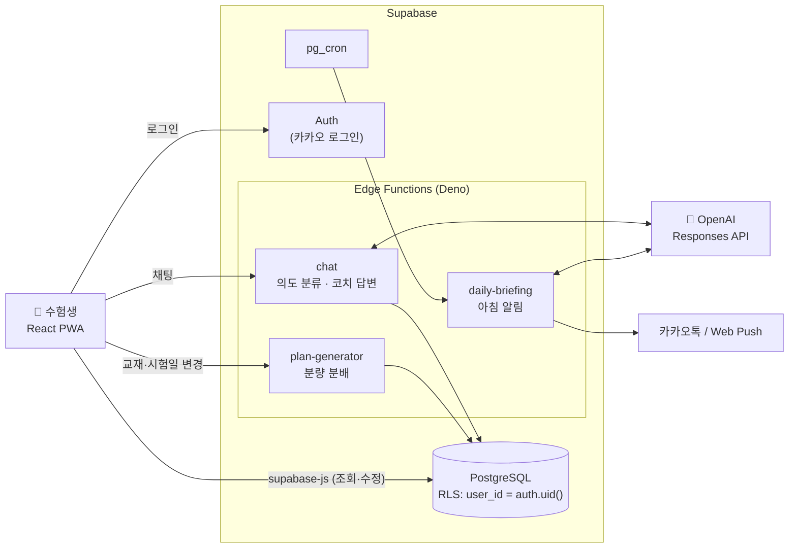
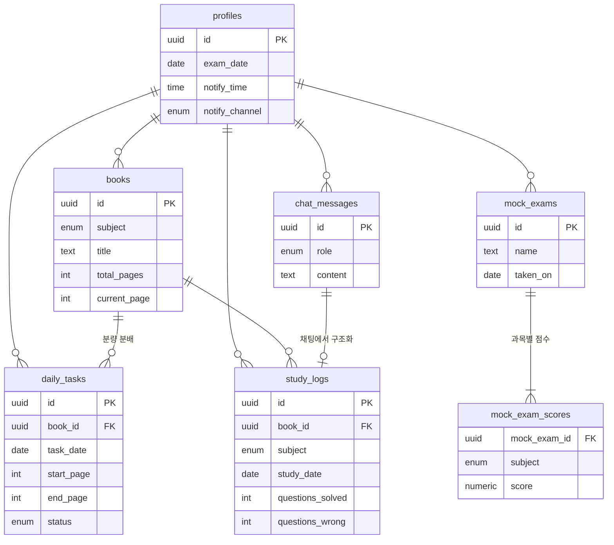

# 📒 보건직 합격 코치 (Study-Agent)

> 매일 아침 오늘 공부할 분량을 알려주고, 채팅으로 공부 기록과 고민을 나누는 **AI 학습 코치** PWA

## ✨ 주제

-   보건직 공무원 수험생을 위한 LLM 기반 학습 관리·멘탈 케어 에이전트

## 📅 기간

-   2026.08.14 ~ 진행 중 (개인 프로젝트)

## 📜 프로젝트 컨셉 및 주요 기능

### 1️⃣ 기획 배경 및 목적

-   공무원 시험은 길게는 1년 넘게 **혼자** 준비하는 장기전이다.
-   교재는 늘어나는데 시험일까지 무엇을 얼마나 해야 하는지 매일 다시 계산해야 하고, 계획이 한 번 밀리면 다시 세우기 어렵다.
-   성적이 정체되면 공부법을 물어볼 곳도, 꾸준함을 알아봐 줄 사람도 없다.
-   **"오늘 할 일은 정해 주고, 기록은 말로 하면 되고, 지칠 때는 근거를 들어 응원해 주는"** 코치를 만드는 것이 목표다.

### 2️⃣ 페르소나

-   보건직(국어·영어·공중보건·보건행정) 시험을 혼자 준비하는 수험생
-   아르바이트와 병행해 하루 공부 시간이 매일 달라지는 수험생
-   모의고사 점수가 오르지 않아 공부법에 확신이 없는 수험생

### 3️⃣ 주요 기능

| 기능 | 설명 | 상태 |
|---|---|---|
| 📆 교재 분량 자동 계획 | 교재와 시험일을 등록하면 남은 분량을 시험 전날까지 날짜별로 나누고, 교재·시험일이 바뀌면 다시 나눈다 | ✅ |
| 💬 채팅 중심 화면 | 하루에 하나씩 쌓이는 채팅방, 상단에 고정된 "오늘의 분량" | ✅ |
| 📊 공부상태 대시보드 | 계획 달성률 잔디, 연속 공부 일수, 이번 주 목표량, 과목별 진도율 | ✅ |
| 🗣 말로 하는 학습 기록 | "보건행정 30~70p, 기출 20문제 중 5개 틀림" → LLM이 구조화해 기록 | 🚧 |
| 🧑‍🏫 과목별 AI 코치 | 점수·진도 데이터를 근거로 공부법 제안 + 칭찬·개선점·멘탈 케어 | 🚧 |
| ⏰ 일정 기반 분량 조정 | "6시부터 알바 4시간" → 남은 시간으로 오늘 분량을 다시 나누고 나머지는 이월 | 🚧 |
| 🔔 매일 아침 알림 | 카카오톡 / PWA 푸시로 오늘의 분량과 응원 메시지 발송 | 🚧 |

✅ 구현 완료 · 🚧 진행 중 — 전체 흐름은 [SERVICE_FLOW.md](SERVICE_FLOW.md)

### 4️⃣ 기대 효과

-   매일 계획을 다시 세우는 시간 없이 **오늘 할 분량만 보고 바로 공부**를 시작할 수 있다.
-   계획이 밀려도 자동으로 다시 나눠져, 하루 놓친 것이 포기로 이어지지 않는다.
-   기록이 쌓일수록 코치의 공부법 제안과 응원이 **내 데이터에 근거**하게 된다.

## 🤖 AI 기술 포인트

### 1️⃣ LLM 에이전트 설계

-   **단일 채팅 엔드포인트 + 의도 분류**: 사용자는 채팅 하나로 말하고, Edge Function `chat`이 의도(학습 기록 / 오늘 일정 / 교재 추가 / 공부법 질문 / 사용법)를 분류해 각 처리로 보낸다.
-   **자연어 → 구조화 데이터**: 학습 기록 보고를 OpenAI Responses API로 구조화(과목, 쪽 범위, 푼 문제·틀린 문제)해 `study_logs`에 저장한다.
-   **데이터 근거 응답 (Grounding)**: 모의고사 점수 추이, 학습 기록, 진도를 프롬프트에 함께 넣어 "벌써 8점 올랐어요"처럼 실제 수치에 근거한 칭찬과 처방만 하도록 한다.
-   **에이전트 + 결정적 로직 분리**: 분량 분배처럼 정확해야 하는 계산은 LLM에 맡기지 않고 `plan-generator`의 결정적 알고리즘으로 처리하고, LLM은 해석과 대화를 맡는다.

### 2️⃣ 프롬프트를 문서로 관리 (Prompt as Docs)

-   코치의 말투([docs/coach](docs/coach/coach-tone.md))와 과목별 공부법([docs/study-methods](docs/study-methods/README.md))을 코드가 아닌 **마크다운 문서**로 관리한다.
-   개발자가 아니어도 수험 노하우를 직접 고칠 수 있고, 이 문서가 Edge Function 프롬프트의 원본이 된다.

### 3️⃣ AI 네이티브 개발 워크플로 (Claude Code)

-   **[CLAUDE.md](CLAUDE.md)** 에 구조·의존 방향·데이터 계약·배포 규칙을 정리해, AI 코딩 에이전트가 프로젝트 규칙을 지키며 작업하게 한다.
-   **Claude Code 플러그인**을 프로젝트 단위로 공유한다(`.claude/settings.json`): Supabase(DB·Edge Functions 지침), Superpowers(계획·디버깅·검증 워크플로), Frontend Design(디자인 기준), Context7(최신 라이브러리 문서 MCP).
-   기획(SERVICE_FLOW) → 디자인(DESIGN) → 구현을 문서 기반으로 AI와 반복하며 진행한다.

## 💻 개발 환경 및 문서

### 1️⃣ 활용 기술

#### 🛠 Front-End 🛠

#### 🛠 Back-End 🛠

-000000?style=for-the-badge&logo=deno&logoColor=white)

#### 🤖 AI 🤖

#### 🛠 CI / CD 🛠

#### 🛠 Tools 🛠

### 2️⃣ Architecture

-   프론트엔드는 `supabase-js`로 DB에 직접 접근하고, 모든 테이블은 **Row Level Security**로 본인 데이터만 다룬다.
-   LLM 호출·알림 발송처럼 비밀 키가 필요한 작업만 Edge Function을 거친다.
-   `develop`에서 작업하고 `main`에 병합하면 Vercel(프론트)과 GitHub Actions(마이그레이션·Edge Functions)로 자동 배포된다.

### 3️⃣ ERD

### 4️⃣ 문서

| 문서 | 내용 |
|---|---|
| [SERVICE_FLOW.md](SERVICE_FLOW.md) | 서비스 흐름, 채팅 의도별 처리, 계획 분배 규칙 |
| [DESIGN.md](DESIGN.md) | 화면 구성, 색상 토큰, 타이포그래피, 컴포넌트 규칙 |
| [docs/coach](docs/coach/coach-tone.md) · [docs/study-methods](docs/study-methods/README.md) | 코치 말투, 과목별 공부법 (프롬프트 원본) |
| [LOCAL_DEV.md](LOCAL_DEV.md) · [DEPLOY.md](DEPLOY.md) | 로컬 실행, 배포 |
| [History](History/README.md) | 작업 기록: 단계별로 고려한 상황, 해결 방법, 결정 과정 |

## 👥 참여 인원

-   개인 프로젝트 — 공무원 시험을 준비하는 친구를 위해 기획·디자인·개발
