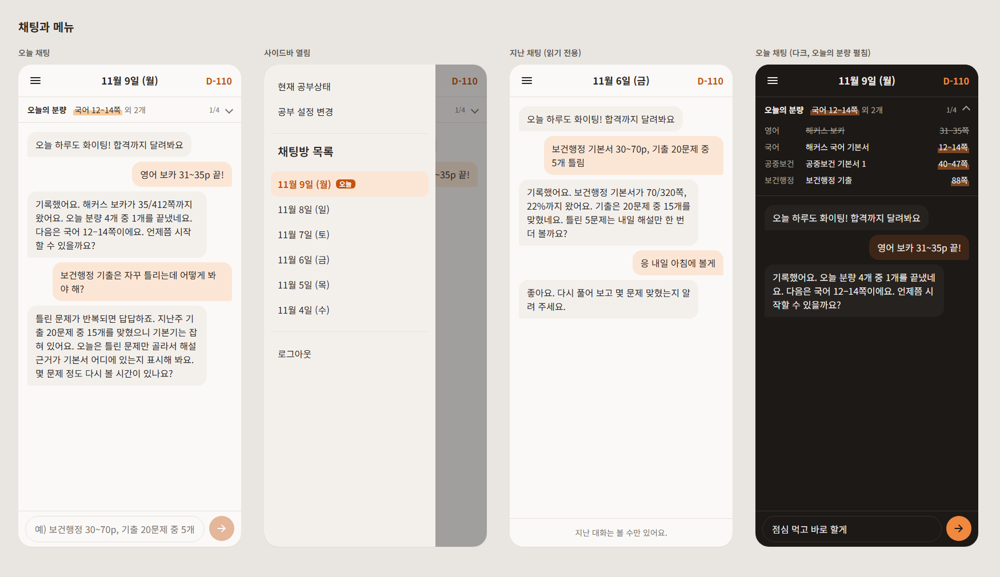
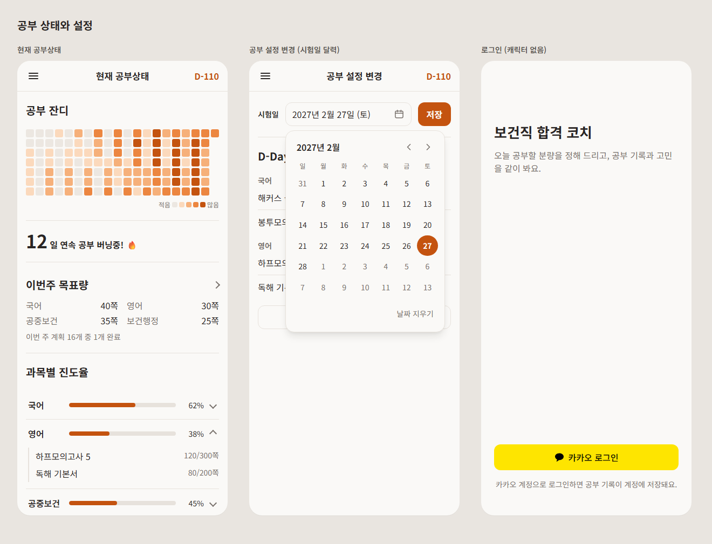
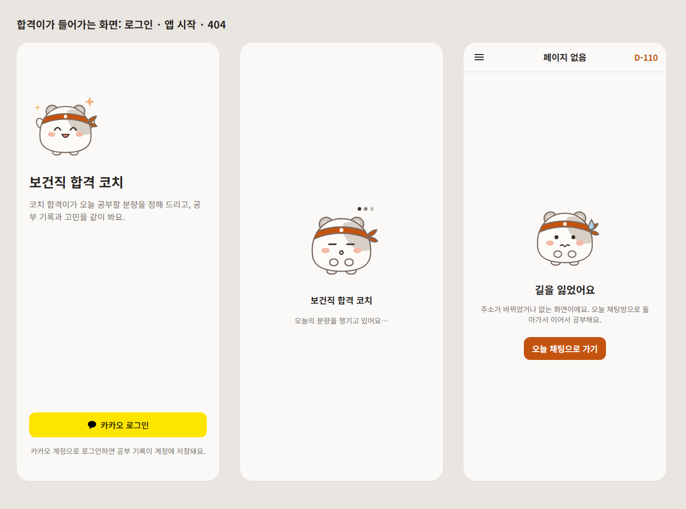
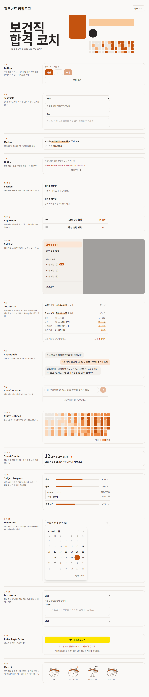
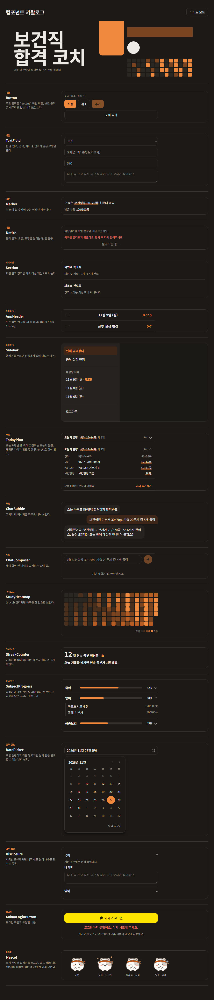

# 디자인 자료

보건직 합격 코치의 디자인 시스템과 화면 시안이다. 화면 규칙의 기준은 [DESIGN.md](../../DESIGN.md)와 `Frontend/src/index.css`이고, 이 폴더는 그 규칙을 그림과 미리보기로 보여 준다. 둘이 다르면 DESIGN.md를 따른다.

  
  
  
  

코치 캐릭터 <b>합격이</b>: 기본 · 응원(로그인) · 생각 중(앱 시작) · 당황(404)

## 폴더

| 파일 | 내용 |
|---|---|
| [design-system/README.md](design-system/README.md) | 브랜드 북: 원칙, 문구, 색상, 타이포, 간격, 레이아웃, 아이콘, 캐릭터, 상태 |
| [design-system/tokens.json](design-system/tokens.json) · [tokens.css](design-system/tokens.css) | 색(라이트·다크), 글자 크기, 간격, 모서리, 크기, 그림자 토큰 |
| [design-system/components.md](design-system/components.md) | 컴포넌트 17개의 사용 규칙 |
| [design-system/catalog.html](design-system/catalog.html) | 컴포넌트 미리보기. 저장소를 받아 브라우저로 연다(`?theme=dark`로 다크) |
| [mockups/screens.html](mockups/screens.html) | 화면 시안 10개. 저장소를 받아 브라우저로 연다 |
| [images/](images/) | 아래 캡처 이미지 |

## 화면 시안

### 채팅과 메뉴

오늘 채팅, 사이드바 열림, 지난 채팅(읽기 전용), 다크 모드(오늘의 분량 펼침).

### 공부 상태와 설정

현재 공부상태(대시보드), 공부 설정(시험일 달력 열림), 로그인(캐릭터 없는 지금 모습).

### 합격이가 들어가는 화면

로그인, 앱 시작(로딩), 404. 캐릭터는 내용이 적은 이 세 화면에만 넣는다.

## 컴포넌트 카탈로그

<table>
  <tr>
    <th>라이트</th>
    <th>다크</th>
  </tr>
  <tr>
    <td></td>
    <td></td>
  </tr>
</table>

## 만든 과정

2026-11-09에 Claude 디자인으로 디자인 시스템과 화면 시안을 만들고, 그 내용을 이 폴더에 파일로 옮겼다. 지금 코드 값을 그대로 옮긴 기준안이다. 캐릭터는 후보 셋 중 합격이로 정했다. 과정은 [History](../../History/2026-11-09-디자인-시스템과-화면-시안.md)에 있다.

- 컴포넌트 미리보기와 화면 시안은 코드를 보고 다시 그린 정적 HTML이다. 실제 공용 컴포넌트와 `/ui` 카탈로그는 로드맵 1.5단계에서 만든다.
- 시안을 고치면 `screens.html`을 고치고 `images/`의 캡처를 다시 만든다(Chrome `--headless --screenshot`).
